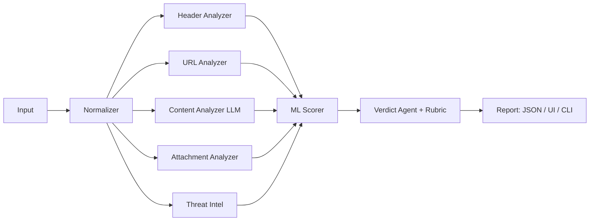

# PhishGuard 🛡️: Agentic Phishing Detector

> A defensive, explainable phishing detection system that combines deterministic security analysis,
> machine learning, threat intelligence, and an LLM agent that explains its findings.


<!-- Add CI, coverage, and release badges in Phase 10 -->

## What it does
Give PhishGuard an **email (.eml)**, a **URL**, or **pasted text**. It returns:
- a verdict: `safe`, `suspicious`, or `phishing`
- a risk score from 0 to 100
- evidence grouped by analyzer (headers, URLs, content, attachments, threat intel, ML)
- extracted IOCs (defanged) and recommended actions
- a plain-language explanation

## Why it is different
Most "LLM phishing detectors" just ask a model. PhishGuard uses a **hybrid pipeline**: deterministic
analyzers and an ML model produce evidence, a transparent rubric computes the label, and the LLM only
explains and (within a hard bound) adjusts. It is also hardened against **prompt injection** and **SSRF**.
See [`docs/04-threat-model.md`](docs/04-threat-model.md).

## Architecture (summary)

Full details: [`docs/03-architecture.md`](docs/03-architecture.md).

## Quickstart
> Filled in during Phase 10. Planned flow:
```bash
git clone <repo-url> && cd phishguard
cp .env.example .env            # add your API keys
uv sync                         # install dependencies
phishguard scan tests/fixtures/emails/fake_bank.eml
phishguard scan-url "hxxps://example[.]test/login"
uvicorn phishguard.api.main:app --reload
streamlit run src/phishguard/ui/app.py
```

## Configuration
| Variable | Required | Purpose |
|---|---|---|
| `GEMINI_API_KEY` | Yes (for LLM features) | LLM via LiteLLM |
| `VIRUSTOTAL_API_KEY` | No | Reputation lookups |
| `URLSCAN_API_KEY` | No | urlscan.io lookups |
| `GOOGLE_SAFE_BROWSING_KEY` | No | Safe Browsing |
| `PHISHGUARD_API_KEY` | For API | API authentication |
| `PHISHGUARD_STORE_RAW` | No (default `false`) | Opt-in raw content storage |

Optional keys degrade gracefully when missing.

## Documentation
| Doc | Description |
|---|---|
| [Phase plan](docs/00-phase-plan.md) | Build phases and status |
| [Project charter](docs/01-project-charter.md) | Problem, scope, goals |
| [Requirements](docs/02-requirements.md) | Functional / non-functional |
| [Architecture](docs/03-architecture.md) | Components and data flow |
| [Threat model](docs/04-threat-model.md) | STRIDE + OWASP LLM Top 10 |
| [Model card](docs/05-model-card.md) | ML model details |
| [API reference](docs/06-api-reference.md) | REST endpoints |
| [Evaluation report](docs/07-evaluation-report.md) | Metrics and error analysis |
| [Deployment guide](docs/08-deployment-guide.md) | Docker and config |
| [Privacy & ethics](docs/09-privacy-and-ethics.md) | Data handling, limits |
| [ADRs](docs/adr/) | Architecture decisions |

## Limitations
PhishGuard is an **assistive tool, not a guarantee**. See the model card and evaluation report for known
false-positive and false-negative patterns.

## License
MIT. See [LICENSE](LICENSE).
