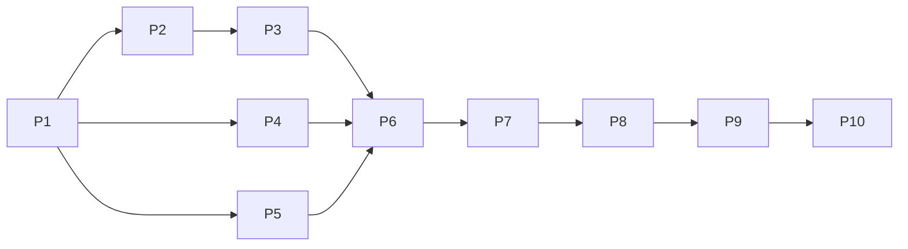

# 00: Phase Plan & Status

**Status legend:** ⬜ not started · 🟨 in progress · ✅ done

| Phase | Goal | Key deliverables | Requirement IDs | Status |
|---|---|---|---|---|
| 0 | Rules, charter, docs skeleton | AGENTS.md, docs 01-09, ADRs | n/a | ✅ (this package) |
| 1 | Foundations | Layout, config, schemas, logging, tooling | NFR-MNT-* | ✅ |
| 2 | Ingestion & parsing | EML parser, URL extractor, normalizer | FR-ING-* | ✅ |
| 3 | Analyzers | Header, URL, content, attachment | FR-HDR-*, FR-URL-*, FR-CNT-*, FR-ATT-* | ✅ |
| 4 | Threat intel | Providers, cache, rate limits | FR-INT-* | ⬜ |
| 5 | ML model | Features, training, model card | FR-ML-* | ⬜ |
| 6 | Agent orchestration | LangGraph, verdict rubric, CLI | FR-AGT-*, FR-VER-* | ⬜ |
| 7 | Security hardening | SafeFetcher, injection defense, PII redaction | NFR-SEC-* | ⬜ |
| 8 | API & UI | FastAPI, Streamlit, persistence | FR-API-*, FR-UI-* | ⬜ |
| 9 | Testing & evaluation | Coverage, ablations, report | NFR-QUAL-*, FR-EVL-* | ⬜ |
| 10 | Docs, Docker, CI, release | Containers, CI, release docs | NFR-OPS-* | ⬜ |

## Phase workflow
1. Give the Antigravity prompt for the phase (in Planning mode).
2. Review the implementation plan and task list before approving.
3. Run lint, type-check, tests, and security scans.
4. Ask the agent for a self-review against `AGENTS.md`.
5. Update this table and `CHANGELOG.md`, then commit with message `phase-N: 
`.

## Dependencies between phases

Phases 3, 4, and 5 can be built in any order once Phase 2 is done.
