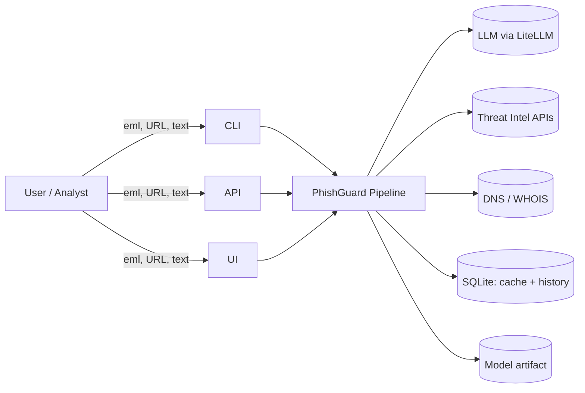
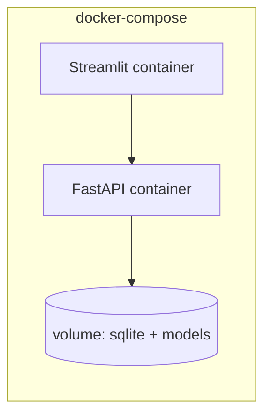

# 03: Architecture

**Status:** Design (v0.1). Update as code lands.

## 1. Principles
1. **Evidence first.** Deterministic analyzers and ML produce typed `Evidence`; the LLM explains it.
2. **Rubric authority.** The label comes from a transparent weighted rubric in code.
3. **Fail soft.** One failing component lowers confidence, never crashes the scan.
4. **Zero trust in input.** All message content is attacker-controlled.
5. **Provider-agnostic.** LLM access through LiteLLM; swap models via config.

## 2. System context


## 3. Pipeline (LangGraph)

Parallel fan-out after `normalize`, fan-in at `ml_scorer`. Each node writes to its own state key to avoid
write conflicts.

## 4. Components
| Component | Module | Responsibility | Trust |
|---|---|---|---|
| Normalizer | `ingest/` | Parse EML, extract URLs/attachments, defang | Handles untrusted data |
| Header analyzer | `analyzers/header.py` | SPF/DKIM/DMARC, spoofing, mismatches | Deterministic |
| URL analyzer | `analyzers/url.py` | Lexical/host heuristics, lookalikes, age | Deterministic |
| Content analyzer | `analyzers/content.py` | LLM semantic analysis, strict schema | LLM, untrusted input inside |
| Attachment analyzer | `analyzers/attachment.py` | Extension/MIME/macro heuristics, hashes | Deterministic, never executes |
| Intel lookup | `intel/` | Reputation lookups, cache | External APIs |
| ML scorer | `ml/` | URL classifier probability + top features | Deterministic at inference |
| Verdict agent | `agents/verdict.py` | Rubric score + LLM explanation | Structured input only |
| SafeFetcher | `core/safe_fetch.py` | SSRF-safe HTTP | Security boundary |
| Redactor | `core/redaction.py` | PII masking before LLM | Privacy boundary |

## 5. Data model (core schemas)
```python
class Severity(StrEnum): INFO, LOW, MEDIUM, HIGH, CRITICAL

class Evidence(BaseModel):
    source: str              # analyzer name
    code: str                # stable ID, e.g. "HDR_DMARC_FAIL"
    severity: Severity
    description: str
    confidence: float        # 0..1
    raw_data: dict[str, Any] # small, non-sensitive

class AnalyzerResult(BaseModel):
    analyzer: str
    status: Literal["ok", "partial", "error", "skipped"]
    evidence: list[Evidence]
    duration_ms: int
    error: str | None

class Verdict(BaseModel):
    scan_id: str
    label: Literal["safe", "suspicious", "phishing"]
    risk_score: int          # 0..100
    confidence: float
    reasons: list[str]
    iocs: list[IOC]          # defanged
    recommended_actions: list[str]
    evidence: list[Evidence]
    degraded_components: list[str]
```
Evidence `code` values are a stable vocabulary documented in the analyzers' module docstrings.

## 6. Scoring rubric (verdict agent)
1. Each `Evidence` contributes `weight(severity) × confidence × analyzer_weight`.
2. ML probability maps to a 0-100 component with its own weight.
3. Threat-intel confirmed-malicious hits act as a **hard floor** (score >= 85).
4. Base score = clipped, normalized sum to 0-100.
5. **LLM adjustment bound:** the verdict LLM may propose an adjustment of **at most ±10 points**, applied only
   with a stated reason. Labels are computed *after* adjustment from fixed thresholds.
6. Thresholds (initial, to be tuned in Phase 9 and recorded in an ADR): `safe` < 30, `suspicious` 30-69,
   `phishing` >= 70.
7. Confidence is reduced for each degraded/failed component.

Initial weights live in `core/scoring.py` as a documented constant table; changes require human approval.

## 7. Prompt-injection architecture
- Only `content_analyzer` sees message text. It receives redacted, length-capped text inside delimiters,
  and its output is validated against a schema.
- `verdict_agent` receives **only** structured Evidence and metadata, so injected text cannot reach the
  component that writes the final report, except as quoted evidence strings, which are escaped and length-limited.
- A regex/heuristic injection detector emits its own Evidence (an injection attempt is itself suspicious).

## 8. Failure handling
| Failure | Behavior |
|---|---|
| Analyzer exception | `AnalyzerResult(status="error")`, confidence reduced, scan continues |
| LLM unavailable/invalid JSON | Retry once, then skip LLM evidence; verdict uses rubric only; flagged degraded |
| Intel quota/timeout | Use cache or skip; flagged degraded |
| All analyzers fail | Verdict `suspicious` with confidence near 0 and a clear "insufficient data" reason |

## 9. Persistence
SQLite via SQLAlchemy. Tables: `scans` (id, created_at, input_type, input_sha256, label, score, verdict_json),
`intel_cache` (indicator, provider, result_json, expires_at). Raw content stored only if
`PHISHGUARD_STORE_RAW=true`.

## 10. Deployment view


## 11. Technology decisions
See [`docs/adr/`](adr/): LangGraph (0002), hybrid scoring (0003), SafeFetcher (0004), model choice (0005),
storage (0006).
