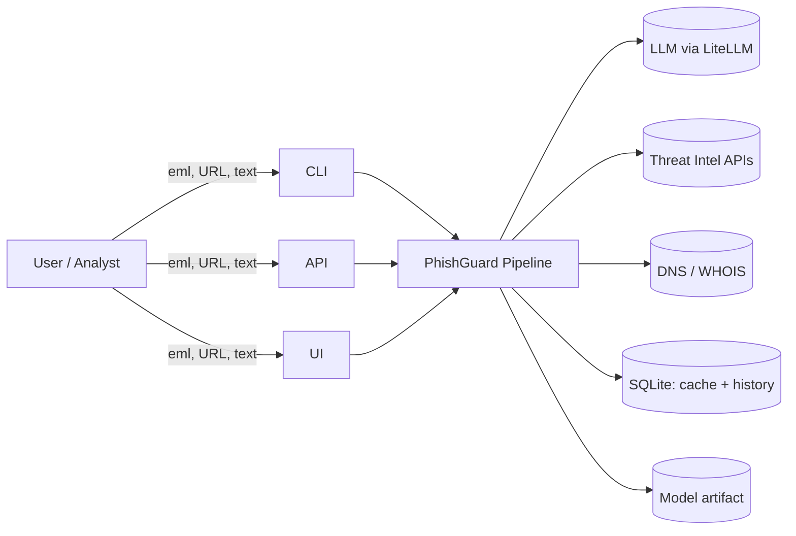
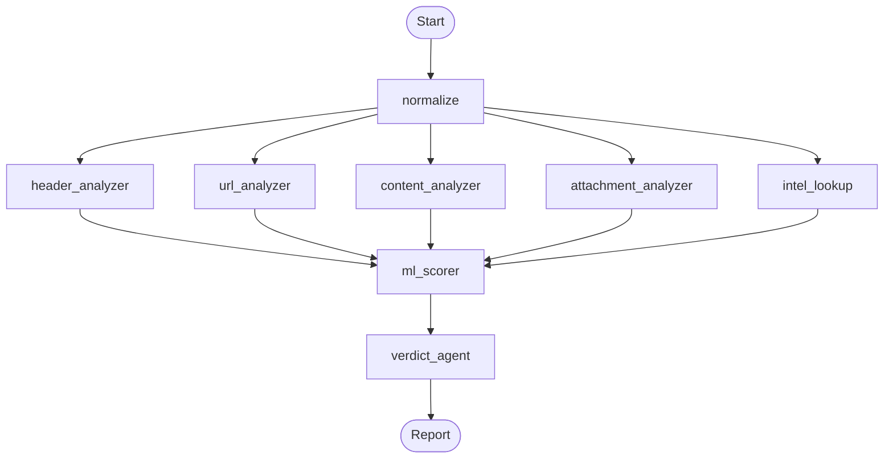
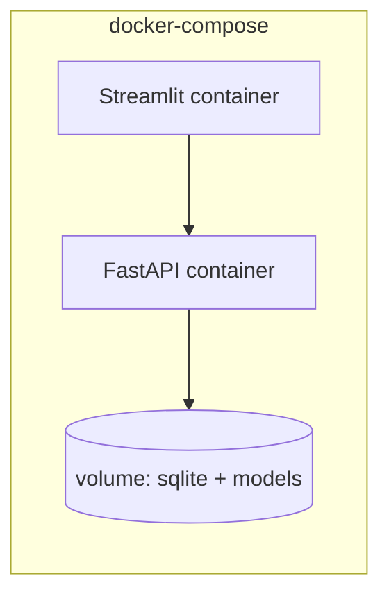

# 03: Architecture

**Status:** Design (v0.1). Update as code lands.

## 1. Principles
1. **Evidence first.** Deterministic analyzers and ML produce typed `Evidence`; the LLM explains it.
2. **Rubric authority.** The label comes from a transparent weighted rubric in code.
3. **Fail soft.** One failing component lowers confidence, never crashes the scan.
4. **Zero trust in input.** All message content is attacker-controlled.
5. **Provider-agnostic.** LLM access through LiteLLM; swap models via config.

## 2. System context


## 3. Pipeline (LangGraph)

Parallel fan-out after `normalize`, fan-in at `ml_scorer`. Each node writes to its own state key to avoid
write conflicts.

## 4. Components
| Component | Module | Responsibility | Trust |
|---|---|---|---|
| Normalizer | `ingest/` | Parse EML, extract URLs/attachments, defang | Handles untrusted data |
| Header analyzer | `analyzers/header.py` | SPF/DKIM/DMARC, spoofing, mismatches | Deterministic |
| URL analyzer | `analyzers/url.py` | Lexical/host heuristics, lookalikes, age | Deterministic |
| Content analyzer | `analyzers/content.py` | LLM semantic analysis, strict schema | LLM, untrusted input inside |
| Attachment analyzer | `analyzers/attachment.py` | Extension/MIME/macro heuristics, hashes | Deterministic, never executes |
| Intel lookup | `intel/` | Reputation lookups, cache | External APIs |
| ML scorer | `ml/` | URL classifier probability + top features | Deterministic at inference |
| Verdict agent | `agents/verdict.py` | Rubric score + LLM explanation | Structured input only |
| SafeFetcher | `core/safe_fetch.py` | SSRF-safe HTTP | Security boundary |
| Redactor | `core/redaction.py` | PII masking before LLM | Privacy boundary |

### Ingestion Data Flow (`src/phishguard/ingest/`)
```mermaid
flowchart TD
  REQ[ScanRequest: eml | url | text] --> DISP[ingest dispatcher]
  DISP -->|eml bytes / rfc5322 text| PARSER[parse_eml / parse_raw_text]
  DISP -->|single url| SYNTH[synthetic ParsedEmail]
  DISP -->|plain text| PLAIN[plain text ParsedEmail]
  PARSER --> HDR[Header extraction & Auth-Results position tracking]
  PARSER --> MIME[Bounded MIME walk & safe attachment hashing]
  PARSER & SYNTH & PLAIN --> EXT[extract_urls & html_to_text]
  EXT --> NORM[normalize_url: IDNA, tracking strip, IP obfuscation]
  NORM --> OUT([ParsedEmail domain model])
```

### Ingestion Limits Reference Table
| Constant | Limit Value | Description | Consequence on Exceeding |
|---|---|---|---|
| `MAX_EMAIL_BYTES` | 10 MB (10,485,760 bytes) | Maximum raw input email byte size | Raises controlled `EmailParseError` |
| `MAX_ATTACHMENT_BYTES` | 25 MB (26,214,400 bytes) | Maximum individual attachment size | Emits `ParseWarning.ATTACHMENT_OVERSIZED` |
| `MAX_ATTACHMENTS` | 50 | Maximum enumerated attachments | Emits `ParseWarning.MAX_ATTACHMENTS_EXCEEDED` |
| `MAX_MIME_DEPTH` | 20 | Maximum multipart recursion depth | Emits `ParseWarning.MAX_MIME_DEPTH_EXCEEDED` |
| `MAX_PARTS` | 100 | Maximum MIME parts traversed | Emits `ParseWarning.MAX_PARTS_EXCEEDED` |
| `MAX_HEADER_COUNT` | 200 | Maximum headers recorded | Emits `ParseWarning.MAX_HEADERS_EXCEEDED` |
| `MAX_HEADER_VALUE_CHARS` | 10,000 | Maximum single header value length | Emits `ParseWarning.HEADER_VALUE_TRUNCATED` |
| `MAX_RECEIVED_HOPS` | 50 | Maximum Received header hops retained | Emits `ParseWarning.MAX_RECEIVED_HOPS_EXCEEDED` |
| `MAX_BODY_CHARS_RETAINED` | 500,000 | Maximum plain/HTML body length | Emits `ParseWarning.MAX_BODY_CHARS_EXCEEDED` |
| `MAX_URL_LENGTH` | 2,048 | Maximum length of single extracted URL | Truncates URL to limit |
| `MAX_URLS_PER_MESSAGE` | 200 | Maximum unique URLs extracted per message | Emits `ParseWarning.MAX_URLS_EXCEEDED` |

## 5. Data model (core schemas)
```python
class Severity(StrEnum): INFO, LOW, MEDIUM, HIGH, CRITICAL

class Evidence(BaseModel):
    source: str              # analyzer name
    code: str                # stable ID, e.g. "HDR_DMARC_FAIL"
    severity: Severity
    description: str
    confidence: float        # 0..1
    raw_data: dict[str, Any] # small, non-sensitive

class AnalyzerResult(BaseModel):
    analyzer: str
    status: Literal["ok", "partial", "error", "skipped"]
    evidence: list[Evidence]
    duration_ms: int
    error: str | None

class Verdict(BaseModel):
    scan_id: str
    label: Literal["safe", "suspicious", "phishing"]
    risk_score: int          # 0..100
    confidence: float
    reasons: list[str]
    iocs: list[IOC]          # defanged
    recommended_actions: list[str]
    evidence: list[Evidence]
    degraded_components: list[str]
```
Evidence `code` values are a stable vocabulary documented in the analyzers' module docstrings.

### Evidence Code Vocabulary (`src/phishguard/analyzers/codes.py`)
| Group | Code | Default Severity | Description |
|---|---|---|---|
| Header | `HDR_SPF_FAIL` | HIGH / MEDIUM | SPF verification hard fail or softfail |
| Header | `HDR_DKIM_FAIL` | MEDIUM | DKIM signature failure or permerror |
| Header | `HDR_DMARC_FAIL` | HIGH | DMARC policy failure |
| Header | `HDR_DMARC_PASS` | INFO | DMARC policy successfully passed |
| Header | `HDR_SPF_ALIGNMENT_FAIL` | MEDIUM | SPF envelope sender domain does not align with From header |
| Header | `HDR_DKIM_ALIGNMENT_FAIL` | MEDIUM | DKIM signing domain (header.d) does not align with From |
| Header | `HDR_MULTIPLE_AUTH_RESULTS` | LOW | Multiple Authentication-Results headers detected |
| Header | `HDR_UNTRUSTED_AUTH_RESULTS` | LOW | Authserv-id not in trusted authserv IDs list |
| Header | `HDR_MISSING_AUTH_RESULTS` | LOW | No Authentication-Results header found |
| Header | `HDR_DOMAIN_MISMATCH_REPLYTO` | HIGH | Reply-To address differs from From address domain |
| Header | `HDR_DOMAIN_MISMATCH_RETURNPATH` | MEDIUM | Return-Path envelope domain differs from From domain |
| Header | `HDR_DISPLAY_NAME_SPOOF` | HIGH | Display name claims brand identity from unauthorized domain |
| Header | `HDR_FREEMAIL_BRAND_SPOOF` | HIGH | Free-mail sender claims corporate brand identity |
| Header | `HDR_EXECUTIVE_TITLE_SPOOF` | LOW | Display name contains executive title without brand match |
| Header | `HDR_RECEIVED_HOP_COUNT_HIGH` | LOW | Email routing contains > 10 Received hops |
| Header | `HDR_RECEIVED_PRIVATE_RELAY` | LOW | Intermediate hop routed through private RFC 1918 space |
| Header | `HDR_RECEIVED_TIME_ANOMALY` | LOW | Routing timestamps are non-chronological or skewed |
| URL | `URL_IP_LITERAL` | MEDIUM | URL points directly to an IP address literal |
| URL | `URL_IP_OBFUSCATED` | HIGH | Host uses obfuscated IP encoding (octal, hex, dword) |
| URL | `URL_EXCESSIVE_SUBDOMAINS` | LOW | Host has >= 3 subdomain levels |
| URL | `URL_USERINFO_TRICK` | HIGH | Embedded user credentials before @ symbol |
| URL | `URL_ODD_PORT` | MEDIUM | Non-standard HTTP/HTTPS port |
| URL | `URL_EXCESSIVE_LENGTH` | LOW | URL length exceeds 200 characters |
| URL | `URL_NON_HTTP_SCHEME` | MEDIUM | Non-http(s) scheme (javascript:, data:, file:) |
| URL | `URL_HOMOGRAPH_IDN` | LOW | Internationalized domain name without mixed-script |
| URL | `URL_HOMOGRAPH_CONFUSABLE` | HIGH | Mixed-script or visual confusable brand lookalike |
| URL | `URL_TYPOSQUAT_BRAND` | HIGH | High string similarity or combosquatting against brand |
| URL | `URL_BRAND_IN_SUBDOMAIN` | HIGH | Brand placed in subdomain to deceive mobile viewers |
| URL | `URL_SAME_LABEL_DIFF_TLD` | HIGH | Exact brand name registered under unapproved TLD |
| URL | `URL_KNOWN_SHORTENER` | LOW | Known URL shortener service |
| URL | `URL_SUSPICIOUS_TLD` | MEDIUM | High-abuse or suspicious top-level domain |
| URL | `URL_LINK_TEXT_MISMATCH` | HIGH | Visible text shows different domain than destination href |
| URL | `URL_DOMAIN_TOO_NEW` | HIGH | Domain registered within last 30 days |
| Content | `CNT_URGENCY` | HIGH / MEDIUM | Artificial urgency, deadlines, or rapid action demand |
| Content | `CNT_CREDENTIAL_HARVEST` | HIGH / MEDIUM | Solicitation of passwords or sensitive credentials |
| Content | `CNT_IMPERSONATION` | HIGH / MEDIUM | Impersonation of authority, coworker, or company |
| Content | `CNT_THREAT_LANGUAGE` | HIGH / MEDIUM | Threatening language regarding account suspension |
| Content | `CNT_PAYMENT_PRESSURE` | HIGH / MEDIUM | Direct pressure for wire transfers or gift cards |
| Content | `CNT_GRAMMAR_ANOMALY` | MEDIUM | Peculiar phrasing, awkward translation artifacts |
| Content | `CNT_PROMPT_INJECTION` | HIGH | Prompt injection or instruction override detected |
| Attachment | `ATT_DANGEROUS_EXTENSION` | CRITICAL / HIGH | Dangerous executable or binary installer extension |
| Attachment | `ATT_DOUBLE_EXTENSION` | CRITICAL | Deceptive double extension (e.g. .pdf.exe) |
| Attachment | `ATT_MACRO_ENABLED` | HIGH | Macro-enabled Office document |
| Attachment | `ATT_ARCHIVE` | LOW | Compressed archive file |
| Attachment | `ATT_SCRIPT_TYPE` | HIGH | Standalone executable script (.ps1, .vbs, .bat, etc.) |
| Attachment | `ATT_RTLO_CHAR` | CRITICAL | Right-to-Left Override (\u202e) character in filename |
| Attachment | `ATT_MIME_MISMATCH` | HIGH | Document extension conflicts with executable MIME type |
| Attachment | `ATT_OVERSIZED` | LOW | Attachment size exceeds 25 MB threshold |

## 6. Scoring rubric (verdict agent)
1. Each `Evidence` contributes `weight(severity) × confidence × analyzer_weight`.
2. ML probability maps to a 0-100 component with its own weight.
3. Threat-intel confirmed-malicious hits act as a **hard floor** (score >= 85).
4. Base score = clipped, normalized sum to 0-100.
5. **LLM adjustment bound:** the verdict LLM may propose an adjustment of **at most ±10 points**, applied only
   with a stated reason. Labels are computed *after* adjustment from fixed thresholds.
6. Thresholds (initial, to be tuned in Phase 9 and recorded in an ADR): `safe` < 30, `suspicious` 30-69,
   `phishing` >= 70.
7. Confidence is reduced for each degraded/failed component.

Initial weights live in `core/scoring.py` as a documented constant table; changes require human approval.

## 7. Prompt-injection architecture
- Only `content_analyzer` sees message text. It receives redacted, length-capped text inside delimiters,
  and its output is validated against a schema.
- `verdict_agent` receives **only** structured Evidence and metadata, so injected text cannot reach the
  component that writes the final report, except as quoted evidence strings, which are escaped and length-limited.
- A regex/heuristic injection detector emits its own Evidence (an injection attempt is itself suspicious).

## 8. Failure handling
| Failure | Behavior |
|---|---|
| Analyzer exception | `AnalyzerResult(status="error")`, confidence reduced, scan continues |
| LLM unavailable/invalid JSON | Retry once, then skip LLM evidence; verdict uses rubric only; flagged degraded |
| Intel quota/timeout | Use cache or skip; flagged degraded |
| All analyzers fail | Verdict `suspicious` with confidence near 0 and a clear "insufficient data" reason |

## 9. Persistence
SQLite via SQLAlchemy. Tables: `scans` (id, created_at, input_type, input_sha256, label, score, verdict_json),
`intel_cache` (indicator, provider, result_json, expires_at). Raw content stored only if
`PHISHGUARD_STORE_RAW=true`.

## 10. Deployment view


## 11. Technology decisions
See [`docs/adr/`](adr/): LangGraph (0002), hybrid scoring (0003), SafeFetcher (0004), model choice (0005),
storage (0006).
